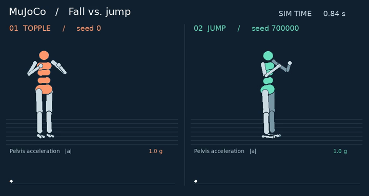

# AIoT Fall Agent · 낙상 후보 감지와 한국어 확인 대화

골반의 관성 센서(IMU)에서 낙상 후보를 찾고, 한국어 대화로 사용자의 상태를 확인하는 프로젝트입니다. **1D CNN**은 가속도·각속도 신호에서 낙상 점수를 계산합니다. **대화 LLM**은 센서 상태와 질문, 음성 인식 결과를 읽고 재확인·경보·상황 종료 중 다음 행동을 제안합니다.

```text
[골반 IMU: 가속도 + 각속도] → [1D CNN: 낙상 후보 점수]
                                      |
                               확인 질문을 시작
                                      v
[센서 상태 + 장치 질문 + STT 전사 이력] → [2B LLM: 근거 + 함수 호출 + 다음 질문]
```

두 모델은 따로 평가했습니다. CNN은 실측 센서 기록에서 낙상을 얼마나 감지하는지, LLM은 합성 음성 전사에서 교사와 같은 행동을 선택하는지 측정했습니다. 실제 기기의 종단 간 성능은 아직 측정하지 않았습니다.

## 1. 낙상 감지 CNN — 점프도 큰 충격을 만듭니다

[](docs/assets/mujoco-replay.mp4)

**MuJoCo 리플레이 · 4.24초** ｜ 왼쪽은 낙상, 오른쪽은 점프입니다. 각 동작 아래에 같은 시점의 골반 가속도를 표시했습니다. [발표용 MP4 다운로드](https://raw.githubusercontent.com/yeounhyeok/aiot-fall-agent/main/docs/assets/mujoco-replay.mp4)


넘어질 때(`topple`, seed 0)와 점프 착지 때(`jump`, seed 700000) 모두 가속도는 약 6.8 g까지 올라갑니다. 차이는 충격 뒤에 보입니다. 하나는 바닥에 눕고, 다른 하나는 선 자세로 돌아옵니다. CNN이 **충격 전후 3초의 가속도·회전·기울기**를 함께 보는 이유입니다. 그림과 영상은 같은 두 시드를 재생해 만들었으며, 6축 신호는 저장된 원본과 일치했습니다.

### MuJoCo 학습 데이터

- **센서와 환경:** MuJoCo 휴머노이드의 골반에 가상 가속도계와 자이로를 달고 6축 신호를 500 Hz로 기록했습니다. 질량, 관절 강성, 지면 접촉 조건, 외력 방향을 바꿔 동작에 변화를 줬습니다. 합성 범위는 정지 상태에서 시작하는 낙상과 일상동작입니다.
- **동작과 수량:** 낙상 3종(넘어짐·앞으로 걸려 넘어짐·힘이 풀려 주저앉음)과 일상동작 5종(서 있기·휘청인 뒤 회복·쪼그리기·허리 굽히기·점프)을 각각 480회씩, 총 **3,840회** 시뮬레이션했습니다. 마지막 몸통 높이가 해당 동작의 기준에 맞는 사례를 종류별 300개씩 보존했습니다. 최종 **2,400개 궤적** 중 낙상이 900개, 일상동작이 1,500개입니다.
- **학습 단위:** 500→100 Hz로 다섯 표본씩 평균을 내고 3초(300시점)씩 잘랐습니다. 낙상은 충격이 창 안의 1.5~2.5초에 들어올 때만, 일상동작은 무작위 구간에서 추출했습니다. 이득·잡음·편향을 더하고 가속도는 ±16 g로 제한했습니다. 유효 창은 총 **9,456개**(낙상 3,456 / 일상 6,000), 그중 학습 7,568 / 합성 검증 1,888입니다. 같은 시뮬레이션의 창은 한 분할에만 들어갑니다.

### 신호에서 낙상 점수까지

[감지기 재현 안내](detector/README.md) · [MuJoCo 생성 코드](detector/scripts/synth_v1.py) · [CNN 구조와 손실](detector/scripts/train_eval.py) · [학습 진입점](detector/scripts/train_synth.py) · [학습된 가중치](detector/weights/net_synth_v1.pt) · [CPU 재평가 원본](detector/results/replay_cpu.json)

`synth_v1`은 **학습 파라미터 32,001개**의 1D CNN입니다. 3초 구간마다 낙상 점수 하나를 출력합니다.

```text
3 × 300  | 가속도 크기(g), 각속도 크기(°/s)/100, 시작 자세 대비 기울기(rad)
    |
     ↓   Conv1d(3→32, k=7)  → BN → ReLU → MaxPool(2)    [32 × 150]
     ↓   Conv1d(32→64, k=5) → BN → ReLU → MaxPool(2)    [64 ×  75]
     ↓   Conv1d(64→64, k=5) → BN → ReLU                 [64 ×  75]
     ↓   시간축 평균 64개 + 최댓값 64개 → Linear(128→1) → 낙상 logit
```

양성 가중치를 적용한 이진 교차엔트로피(`BCEWithLogitsLoss`)와 Adam(lr 0.001)을 사용해 배치 128로 15에폭 학습했습니다.

**실측 평가 · SisFall.** 3초 창을 0.25초씩 옮겨 얻은 점수 중 최댓값이 0.5를 넘으면 낙상으로 판정했습니다. 합성 데이터로만 학습한 CNN은 **낙상 673건 중 390건을 감지**했고(재현율 57.9%), **일상동작 1,522건 중 5건에 오경보**를 냈습니다(0.33%). AUC는 0.959였습니다. 오경보는 적었지만 낙상 283건을 놓쳤습니다. [기존 가중치로 재평가한 결과](detector/results/replay_cpu.json)

## 2. 대화 LLM — 전사된 대화로 다음 행동 학습

```text
① openai/gpt-oss-20b: 한국어 상황·장치 질문·사용자 응답 대본 작성
                |
② 사용자 응답 → MMS-TTS-kor → 16 kHz WAV → clean / noise / clip → Whisper-base
                |                                                 |
                |                           모의 센서 상태 + 질문 + STT 전사 (두 턴)
                |                                                 |
③               └─ 원 대본은 여기서 제외              +------------+------------+
                                                    |                         |
                                         20B 블라인드 검토          20B 교사 독립 응답
                                         행동·인용 기준 생성         다음 행동 JSON 생성
                                                    |                         |
                                                    +------ 일치·근거 검사 -----+
                                                                 |
④ 후보 14,680 → 최종 10,000 → 첫 관측 턴별 분할 → 학습 9,464 / 검증 536
                                                                 |
⑤ Qwen3.5-2B + LoRA  ←  전사를 입력으로, 교사의 최종 행동 JSON을 정답으로 SFT
```

**① 한국어 대본 작성.** `openai/gpt-oss-20b`가 장치 질문과 사용자 응답을 작성했습니다(온도 0.95). 사용자 응답은 다음 단계에서 음성으로 합성합니다.

**② 장치가 실제로 받게 될 입력을 만들었습니다.** `facebook/mms-tts-kor`로 사용자 응답을 16 kHz WAV로 합성했습니다. 턴마다 깨끗한 음성, 잡음 추가, 끝 잘림을 65:24:11 가중치로 뽑았습니다. `openai/whisper-base`로 한국어를 greedy 전사하고 틀린 단어도 고치지 않았습니다. 학생에게 남는 것은 각 턴의 `sensor`, `device`, `transcript`뿐입니다.

**③ 교사 라벨 생성.** 같은 GPT-OSS-20B에 두 가지 요청을 따로 보냈습니다. 검토 요청에서는 원 대본 없이 관측 이력을 읽고 행동 경로와 마지막 발화의 근거 구절을 골랐습니다. 답안 생성 요청에서는 검토 라벨을 보여주지 않고 `evidence`, `call`, `next_prompt`를 받았습니다. 함수·인자·후속 경로와 인용 근거를 대조하고, 검사를 통과하지 못하면 다른 시드로 한 번만 재시도했습니다.

**④ 검사를 통과한 것만 SFT 예제로 바꿨습니다.** 대화 초안 23,760개에서 교사 단계로 21,075개가 넘어갔습니다. 1차 또는 재시도를 통과한 후보 14,680개에서 질문 반복·근거가 부족한 종료/경보 등을 제외해 서로 다른 두 턴 이력 **10,000개**를 남겼습니다. 팀원은 공유된 교사 라벨과 TTS→STT 사례를 직접 확인했습니다(1만 건 전체가 아닌 사례 검토입니다). 같은 첫 관측 턴을 공유하는 이력들은 해시로 묶어 학습·검증 양쪽에 걸치지 않게 했습니다.

**학습 예시.** 장치가 “지금 어디가 불편하세요?”라고 물었을 때 Whisper는 “이 혹 실문화 피쳐봐서 물건이”라고 전사했습니다. 교사는 이 말만으로 상태를 단정하지 않고 다시 묻는 행동을 골랐습니다.

```json
{"evidence":"이 혹 실문화 피쳐봐서 물건이","call":{"name":"ask_checkin","arguments":{"reason":"unclear_reply"}},"next_prompt":"clarify_status"}
```

**⑤ 교사의 판단 결과를 2B 학생에게 증류했습니다.** 여기서 지식 증류는 교사의 확률분포나 숨은 사고 과정을 복사하는 것이 아닙니다. `Qwen/Qwen3.5-2B`에 동일한 관측 이력을 주고, **교사가 채택한 최종 JSON과 EOS 한 개**를 생성하게 하는 지도 미세조정(SFT)입니다. 질문·이력·패딩 토큰은 `-100`으로 마스킹해 손실에서 제외했습니다.

| 학생 학습 설정 | 실제 사용값 |
|---|---|
| 업데이트 범위 | 기본 가중치 고정. 언어층의 선형 어텐션·셀프 어텐션·MLP 투영에만 LoRA 적용, 비전부 제외 |
| LoRA | rank 16, alpha 32, dropout 0.05 · 학습 파라미터 16,819,200개(전체의 0.754%) |
| 최적화 | BF16, AdamW, LR 0.0001, warmup 10스텝 뒤 cosine · microbatch 4 × 누적 4 |
| 학습 길이 | 9,464건 × 1에폭, 592 업데이트 · 최종 step 592 어댑터를 평가 |
| 비교 조건 | 같은 536개 검증 입력, thinking off, greedy, 최대 160개 생성 토큰 · 함수 이름·인자·후속 질문 경로 모두 일치해야 행동 정답 |

### 평가 결과: 교사와의 행동 일치도

| 검증 지표 | 미튜닝 | SFT |
|---|---:|---:|
| 행동 전체 일치 | 0/536 | 512/536 (95.5%) |
| 근거까지 포함한 JSON 전체 일치 | 0/536 | 422/536 (78.7%) |
| 교사 경보를 놓침 | 32/32 | 2/32 |
| 교사 비경보에 경보를 냄 | 0/504 | 0/504 |

항상 상태 재확인만 고르는 기준선도 444/536(82.8%)입니다. SFT는 이보다 68건을 더 맞혔지만, 직전 질문을 반복해야 하는 19건은 모두 상태 재확인으로 돌렸습니다. 미튜닝 0점은 이 직접 호출 조건에서 지정한 함수 형식을 맞히지 못했다는 뜻입니다. **이 점수는 합성 전사에서의 교사 일치도이지 실사용 낙상 감지 정확도가 아닙니다.** [집계 원본](https://huggingface.co/yeopeter1031/aiot-fall-qwen3.5-2b-lora-r1/resolve/acd4d0a750731a600386d27c3969deb789dc6f1e/evaluation.json)

## Jetson에서 에이전트 실행: BLE 또는 USB

**착용 모드:** 보조배터리로 구동한 UNO R4 WiFi가 MPU6050의 6축 신호만 BLE로 보냅니다. 마이크와 스피커는 Jetson에 유선으로 연결합니다. [BLE 스케치·배선·실행 안내](docs/ble-imu.md)

```sh
python3 -m runtime live --ble-address "$UNO_BLE_ADDRESS" --asr-dir /models/whisper-base
```

**USB 백업 모드:**

[MPU6050·Arduino USB 배선과 펌웨어](docs/wired-imu.md) · [마이크·스피커·로컬 모델 준비](docs/local-dialogue.md) · [개인 안내 음성 팩](device_audio/README.md)

보드에 스케치를 올리고 USB 포트를 확인한 뒤, 안내 WAV와 Whisper를 로컬에 준비하고 프로젝트 GGUF로 `llama-server`를 먼저 실행하세요. 아래 명령은 저장소 루트 기준이며 포트와 모델 경로는 실제 장치에 맞춰 바꿉니다. 실행 중 모델을 내려받지 않습니다.

```sh
python3 -m runtime live --port /dev/ttyACM0 --asr-dir /models/whisper-base
```

CNN이 후보를 잡으면 안내를 재생하고 답을 듣습니다. 매 턴 새 센서 관측과 음성 전사를 함께 판단해 재질문·도움 요청·종료를 선택하고, 이벤트 처리가 끝나면 감시를 재개합니다. 무응답은 최대 4턴 후 미확인으로 남깁니다. 실제 Discord 알림은 비공개 환경변수 설정 후 `--discord`를 명시해야 활성화됩니다. 실제 UNO·Jetson에서의 종단 간 동작은 아직 확인하지 않았습니다.

## Discord 도움 요청 알림

[알림 함수](notifications/discord_alert.py)는 대화 모델의 결정 JSON을 받아 `raise_alert` + `help_requested`이고 `next_prompt`가 `null`일 때만 고정 문구를 보냅니다. 센서 후보·재확인·상황 종료는 전송하지 않습니다. 원음·전사·인용·사용자 정보도 보내지 않습니다. 외부 알림은 선택 사항이며 오프라인에서는 로컬 장치 동작을 우선하세요.

- 장치 실행 환경에 `FALL_AGENT_DISCORD_WEBHOOK_URL`을 비공개로 설정하세요. 실제 URL은 저장소에 넣지 않습니다.
- 연결 테스트: `python3 notifications/discord_alert.py --test` (실제 채널에 테스트 메시지 1건 전송).
- 장치 통합: 이벤트가 확정될 때 한 번 `notify_decision(decision)`을 호출하거나, `python3 notifications/discord_alert.py --decision-stdin < decision.json`으로 전달하세요. 반환값 `sent`에는 Discord 메시지 ID가 포함됩니다. `unconfirmed`는 전송 여부가 불명확하므로 자동 재시도하지 않습니다. 이는 채널 알림이며 응급 신고 기능이 아닙니다.

## 재현 자료 · Hugging Face와 Colab

- [Colab에서 노트북 열기](https://colab.research.google.com/github/yeounhyeok/aiot-fall-agent/blob/main/notebooks/fall_dialogue_sft.ipynb) · [노트북 파일](notebooks/fall_dialogue_sft.ipynb) — 기본 모드는 CPU에서 자료 해시와 분할을 확인하고 기존 평가 결과를 표시합니다.
- [모델: 최종 LoRA + 중간 체크포인트 5개](https://huggingface.co/yeopeter1031/aiot-fall-qwen3.5-2b-lora-r1/tree/acd4d0a750731a600386d27c3969deb789dc6f1e) — 루트는 평가에 사용한 step 592입니다. 단독 모델이 아니므로 같은 저장소의 카드에 명시된 Qwen 원본과 함께 사용합니다.
- [티처 입력·출력, 선별 이력, 실제 SFT 분할](https://huggingface.co/datasets/yeopeter1031/aiot-fall-dialogue-teacher-10k-r1/tree/9082fca9a954148bba5deeee6cdb459b457414b2) — 학습에는 `sft/train.jsonl`만 사용합니다. 후보 보관 파일에는 검증 사례도 포함됩니다.
- [합성 음성 원본과 대화 ID별 매핑](https://huggingface.co/datasets/yeopeter1031/aiot-fall-dialogue-synthetic-audio-r1/tree/0b899dc20412071f3da36cea538b66e5b12ff144) — `row_audio.jsonl`에서 해당 턴의 ZIP과 WAV 경로를 확인할 수 있습니다. 실제 사람이나 낙상 현장의 녹음은 아닙니다.

## 재현 범위

노트북의 기본값 `RUN_TRAINING=False`는 추가 학습이나 모델 다운로드 없이 실행됩니다. 새 어댑터가 필요할 때만 BF16 지원 GPU에서 `True`로 설정하세요. 기존 점수는 새로 돌린 결과와 구분해 표시합니다. GGUF 배포본이나 실기기 통합 검증은 제공하지 않습니다.

## 초기 파일럿 (현재 10K 결과와 별개)

### 바로 실행 (저장소 루트, Python 3 표준 라이브러리)
```sh
python3 harness.py examples/cases.jsonl
python3 harness.py examples/cases.jsonl examples/mock_predictions.jsonl
python3 -m unittest -v
```
예시는 AI가 만든 모의 대화 3건으로, 팀이 검수한 학습·테스트셋이 아닙니다. 모의 예측 하나는 도움 요청을 잘못 해제하도록 작성했습니다. 정상 출력은 3건 중 정확히 일치 2건, 도움 요청 오해제 1건입니다. **모델 성능이 아닙니다.**

### 초기 파일럿의 사례 작성 규칙
1. `examples/cases.jsonl`을 참고해 `data/team_cases.jsonl`에 가명·모의 상황으로 원본을 한 줄씩 작성합니다. `id`는 사례별 고유값, `family`는 같은 원본과 변형이 공유하는 값입니다. 센서 상태가 모의인지 실측인지 표시합니다. 실제 이름, 연락처, 녹음은 커밋하지 않습니다.
2. 정답은 `raise_alert(help_requested)`, `ask_checkin(unclear_reply)`, `close_event(false_alarm)` 중 선택합니다. 이것은 첫 실험용 계약이며 의료 대응 기준이 아닙니다. 무응답 타이머는 LLM 채점 대상이 아닙니다.
3. 원본을 팀원이 교차 검토합니다. `source`에 작성 방식, 추가 필드 `reviewer`와 `review_note`에 검수자 별칭과 수정 이유를 남깁니다. 원본 단위로 `train`, `val`, `test`를 지정한 뒤 train에만 변형을 추가합니다. 모든 분할을 한 파일로 검사해야 가족 간 누출을 잡을 수 있습니다.
4. 모델에는 `sensor`, `question`, `reply`만 전달합니다. `gold`, ID, 출처는 프롬프트에 넣지 않습니다. 같은 테스트 사례로 모델별 `{"id":"…","call":{"name":"…","arguments":{"reason":"…"}}}` 예측 파일을 만들어 각각 채점합니다.
