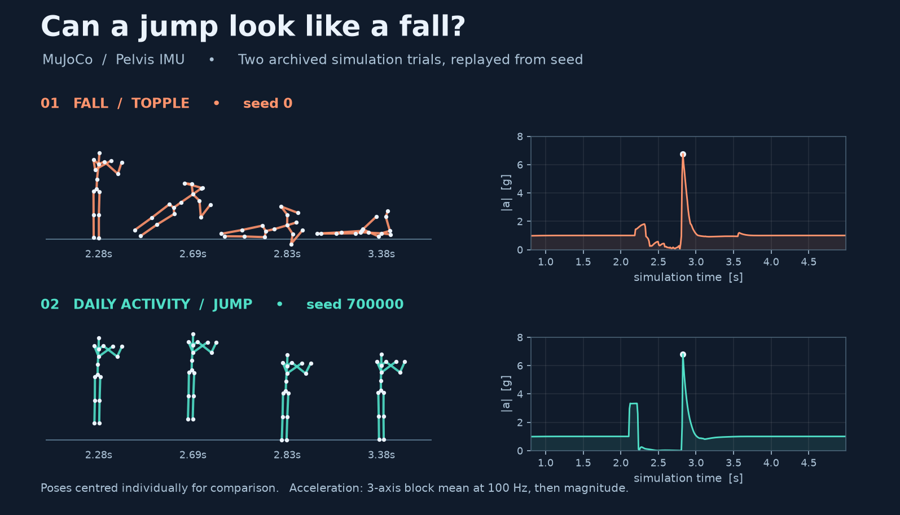

# AIoT Fall Agent · 낙상 후보 감지와 한국어 확인 대화

**넘어진 것과 점프해서 착지한 것을 센서로 어떻게 구분할까요? 센서가 낙상을 의심했는데 사람의 대답이 불분명하면 어떻게 해야 할까요?** 두 판단을 한 모델에 맡기지 않았습니다. 1D CNN은 골반의 움직임으로 낙상 후보를 찾고, 대화 LLM은 장치가 물은 말과 실제 전사된 대답을 보고 다음 행동을 제안합니다.

```text
[골반 IMU: 가속도 + 각속도] → [1D CNN: 낙상 후보 점수]
                                      |
                               확인 질문을 시작
                                      v
[센서 상태 + 장치 질문 + STT 전사 이력] → [2B LLM: 근거 + 함수 호출 + 다음 질문]
```

위 그림은 두 모델이 만나는 **시스템 설계**입니다. 아래 실험에서는 CNN은 센서 기록으로, LLM은 모의 센서 상태와 합성 음성 전사로 각각 평가했습니다. 실제 기기에서 두 모델을 연결해 얻은 종단 간 점수는 아닙니다.

## 1. 낙상 감지 CNN — 점프도 큰 충격을 만듭니다



**그림 읽기.** 위는 넘어짐(`topple`, seed 0), 아래는 점프(`jump`, seed 700000)입니다. 왼쪽은 각 시점의 골격을 가운데 맞춰 그린 것이고, 오른쪽은 같은 실행에서 얻은 골반 가속도 크기입니다. 두 사례 모두 큰 피크가 있지만 충격 뒤 자세는 다릅니다. 그래서 CNN에는 최대 가속도 한 값이 아니라 **충격 전후 3초의 가속도·회전·기울기**를 줬습니다. 두 시드를 다시 실행해 저장된 6축 신호와 일치하는지 확인했습니다. 사람을 촬영한 영상이나 임의로 그린 개념도가 아닙니다.

### 어떤 데이터를 어떻게 뽑았나요?

- **생성기:** Gazebo가 아니라 **MuJoCo**의 휴머노이드입니다. 골반에 가상 가속도계와 자이로를 달고, 질량·관절 강성·지면 접촉·외력 방향을 바꿔 500 Hz로 6축 신호를 기록했습니다. 정지 상태에서 시작하는 동작이 중심이라 보행 중 낙상까지 포괄하지 않습니다.
- **8개 동작:** 낙상 3종(넘어짐·앞으로 걸려 넘어짐·힘이 풀려 주저앉음), 일상동작 5종(서 있기·휘청인 뒤 회복·쪼그리기·허리 굽히기·점프)입니다. 종류별로 480회씩 **3,840회** 시도하고, 최종 몸통 높이로 의도한 동작인지 확인한 뒤 종류별 최대 300개를 보존했습니다. 최종 **2,400개 궤적 = 낙상 900 + 일상동작 1,500**입니다. 보존되지 않은 시도가 전부 물리 오류였다는 뜻은 아닙니다.
- **학습 단위:** 500→100 Hz로 다섯 표본씩 평균을 내고 3초(300시점)씩 잘랐습니다. 낙상은 충격이 창 안의 1.5~2.5초에 들어올 때만, 일상동작은 무작위 구간에서 추출했습니다. 이득·잡음·편향을 더하고 가속도는 ±16 g로 제한했습니다. 유효 창은 총 **9,456개**(낙상 3,456 / 일상 6,000), 그중 학습 7,568 / 합성 검증 1,888입니다. 같은 시뮬레이션의 창은 한 분할에만 들어갑니다.

### 신호에서 낙상 점수까지

```text
3 × 300  | 가속도 크기(g), 각속도 크기(°/s)/100, 시작 자세 대비 기울기(rad)
    |
    +--> Conv1d(3→32, k=7)  → BN → ReLU → MaxPool(2)    [32 × 150]
    +--> Conv1d(32→64, k=5) → BN → ReLU → MaxPool(2)    [64 ×  75]
    +--> Conv1d(64→64, k=5) → BN → ReLU                 [64 ×  75]
    +--> 시간축 평균 64개 + 최댓값 64개 → Linear(128→1) → 낙상 logit
```

양성 가중치를 준 이진 교차엔트로피(`BCEWithLogitsLoss`), Adam(lr 0.001), 배치 128로 15에폭 학습했습니다. 실측 **SisFall**에서는 0.25초 간격으로 창을 옮겨 가장 높은 sigmoid 점수를 기록 한 건의 점수로 삼았습니다. 합성으로만 학습한 CNN은 임계값 0.5에서 **낙상 390/673건 검출(57.9%)**, **일상동작 5/1,522건 오경보(0.33%)**, AUC 0.959였습니다. 오경보는 적지만 놓친 낙상도 많습니다. SisFall을 학습한 별도의 비교 모델 결과를 이 수치에 섞지 않았습니다.

## 2. 대화 LLM — 대본의 의도가 아니라 장치가 들은 말로 증류합니다

```text
① openai/gpt-oss-20b: 한국어 상황·장치 질문·사용자 응답 대본 작성
                |
② 사용자 응답 → MMS-TTS-kor → 16 kHz WAV → clean / noise / clip → Whisper-base
                |                                                 |
                |                           모의 센서 상태 + 질문 + STT 전사 (두 턴)
                |                                                 |
③               └─ 원 대본은 여기서 제외              +------------+------------+
                                                    |                         |
                                         20B 블라인드 검토          20B 교사 독립 응답
                                         행동·인용 기준 생성         다음 행동 JSON 생성
                                                    |                         |
                                                    +------ 일치·근거 검사 -----+
                                                                 |
④ 후보 14,680 → 최종 10,000 → 첫 관측 턴별 분할 → 학습 9,464 / 검증 536
                                                                 |
⑤ Qwen3.5-2B + LoRA  ←  전사를 입력으로, 교사의 최종 행동 JSON을 정답으로 SFT
```

**① 대본을 먼저 생성했습니다.** `openai/gpt-oss-20b`가 한국어 질문과 사용자 응답을 작성했습니다(온도 0.95). 이 응답은 음성 합성용 대본이지, 학생이 입력으로 받는 정답 전사가 아닙니다.

**② 장치가 실제로 받게 될 입력을 만들었습니다.** `facebook/mms-tts-kor`로 사용자 응답을 16 kHz WAV로 합성했습니다. 턴마다 깨끗한 음성, 잡음 추가, 끝 잘림을 65:24:11 가중치로 뽑았습니다. `openai/whisper-base`로 한국어를 greedy 전사하고 틀린 단어도 고치지 않았습니다. 학생에게 남는 것은 각 턴의 `sensor`, `device`, `transcript`뿐입니다.

**③ 전사를 본 뒤에 교사 정답을 다시 만들었습니다.** 같은 GPT-OSS-20B를 별도 요청 두 개로 썼습니다. 검토 요청은 원 대본 없이 전사를 읽고 행동 경로와 마지막 발화의 근거 구절을 정했습니다. 답안 생성 요청은 **검토 라벨도 보지 않고** 같은 이력에서 `evidence`, `call`, `next_prompt`를 생성했습니다. 함수·인자·후속 경로와 인용 근거를 대조하고, 탈락하면 다른 시드로 한 번만 재시도했습니다. 같은 모델의 두 요청이지 독립된 두 사람의 판정은 아닙니다.

**④ 검사를 통과한 것만 SFT 예제로 바꿨습니다.** 대화 초안 23,760개에서 교사 단계로 21,075개가 넘어갔습니다. 1차 또는 재시도를 통과한 후보 14,680개에서 질문 반복·근거가 부족한 종료/경보 등을 제외해 서로 다른 두 턴 이력 **10,000개**를 남겼습니다. 팀원은 공유된 교사 라벨과 TTS→STT 사례를 직접 확인했습니다(1만 건 전수 수검은 아닙니다). 같은 첫 관측 턴을 공유하는 이력들은 해시로 묶어 학습·검증 양쪽에 걸치지 않게 했습니다.

**실제 한 건.** 장치가 “지금 어디가 불편하세요?”라고 물었을 때 Whisper 전사는 “이 혹 실문화 피쳐봐서 물건이”였습니다. 원 대본의 의도를 복원해 경보나 종료를 지시하는 대신, 이 예제의 교사는 다음 JSON을 남겼습니다.

```json
{"evidence":"이 혹 실문화 피쳐봐서 물건이","call":{"name":"ask_checkin","arguments":{"reason":"unclear_reply"}},"next_prompt":"clarify_status"}
```

**⑤ 교사의 판단 결과를 2B 학생에게 증류했습니다.** 여기서 지식 증류는 교사의 확률분포나 숨은 사고 과정을 복사하는 것이 아닙니다. `Qwen/Qwen3.5-2B`에 동일한 관측 이력을 주고, **교사가 채택한 최종 JSON과 EOS 한 개**를 생성하게 하는 지도 미세조정(SFT)입니다. 질문·이력·패딩 토큰은 `-100`으로 마스킹해 손실에서 제외했습니다.

| 학생 학습 설정 | 실제 사용값 |
|---|---|
| 업데이트 범위 | 기본 가중치 고정. 언어층의 선형 어텐션·셀프 어텐션·MLP 투영에만 LoRA 적용, 비전부 제외 |
| LoRA | rank 16, alpha 32, dropout 0.05 · 학습 파라미터 16,819,200개(전체의 0.754%) |
| 최적화 | BF16, AdamW, LR 0.0001, warmup 10스텝 뒤 cosine · microbatch 4 × 누적 4 |
| 학습 길이 | 9,464건 × 1에폭, 592 업데이트 · 최종 step 592 어댑터를 평가 |
| 비교 조건 | 같은 536개 검증 입력, thinking off, greedy, 최대 160개 생성 토큰 · 함수 이름·인자·후속 질문 경로 모두 일치해야 행동 정답 |

### 학생이 교사 행동을 얼마나 재현했나요?

| 검증 지표 | 미튜닝 | SFT |
|---|---:|---:|
| 행동 전체 일치 | 0/536 | 512/536 (95.5%) |
| 근거까지 포함한 JSON 전체 일치 | 0/536 | 422/536 (78.7%) |
| 교사 경보를 놓침 | 32/32 | 2/32 |
| 교사 비경보에 경보를 냄 | 0/504 | 0/504 |

항상 상태 재확인만 고르는 기준선도 444/536(82.8%)입니다. SFT는 이보다 68건을 더 맞혔지만, 직전 질문을 반복해야 하는 19건은 모두 상태 재확인으로 돌렸습니다. 미튜닝 0점은 이 직접 호출 조건에서 지정한 함수 형식을 맞히지 못했다는 뜻입니다. **이 점수는 합성 전사에서의 교사 일치도이지 실사용 낙상 감지 정확도가 아닙니다.** [집계 원본](https://huggingface.co/yeopeter1031/aiot-fall-qwen3.5-2b-lora-r1/resolve/acd4d0a750731a600386d27c3969deb789dc6f1e/evaluation.json)

## 재현 자료 · Hugging Face와 Colab

- [Colab에서 노트북 열기](https://colab.research.google.com/github/yeounhyeok/aiot-fall-agent/blob/main/notebooks/fall_dialogue_sft.ipynb) · [노트북 파일](notebooks/fall_dialogue_sft.ipynb) — 기본 모드는 CPU에서 자료 해시와 분할을 확인하고 기존 평가 결과를 표시합니다.
- [모델: 최종 LoRA + 중간 체크포인트 5개](https://huggingface.co/yeopeter1031/aiot-fall-qwen3.5-2b-lora-r1/tree/acd4d0a750731a600386d27c3969deb789dc6f1e) — 루트는 평가에 사용한 step 592입니다. 단독 모델이 아니므로 같은 저장소의 카드에 명시된 Qwen 원본과 함께 사용합니다.
- [티처 입력·출력, 선별 이력, 실제 SFT 분할](https://huggingface.co/datasets/yeopeter1031/aiot-fall-dialogue-teacher-10k-r1/tree/9082fca9a954148bba5deeee6cdb459b457414b2) — 학습에는 `sft/train.jsonl`만 사용합니다. 후보 보관 파일에는 검증 사례도 포함됩니다.
- [합성 음성 원본과 대화 ID별 매핑](https://huggingface.co/datasets/yeopeter1031/aiot-fall-dialogue-synthetic-audio-r1/tree/0b899dc20412071f3da36cea538b66e5b12ff144) — `row_audio.jsonl`에서 해당 턴의 ZIP과 WAV 경로를 확인할 수 있습니다. 실제 사람이나 낙상 현장의 녹음은 아닙니다.

## 재현 범위

노트북의 기본값 `RUN_TRAINING=False`는 추가 학습이나 모델 다운로드 없이 실행됩니다. 새 어댑터가 필요할 때만 BF16 지원 GPU에서 `True`로 설정하세요. 기존 점수는 새로 돌린 결과와 구분해 표시합니다. GGUF 배포본이나 실기기 통합 검증은 제공하지 않습니다.

## 초기 파일럿 (현재 10K 결과와 별개)

### 바로 실행 (저장소 루트, Python 3 표준 라이브러리)
```sh
python3 harness.py examples/cases.jsonl
python3 harness.py examples/cases.jsonl examples/mock_predictions.jsonl
python3 -m unittest -v
```
예시는 AI가 만든 모의 대화 3건으로, 팀이 검수한 학습·테스트셋이 아닙니다. 모의 예측 하나는 도움 요청을 잘못 해제하도록 작성했습니다. 정상 출력은 3건 중 정확히 일치 2건, 도움 요청 오해제 1건입니다. **모델 성능이 아닙니다.**

### 초기 파일럿의 사례 작성 규칙
1. `examples/cases.jsonl`을 참고해 `data/team_cases.jsonl`에 가명·모의 상황으로 원본을 한 줄씩 작성합니다. `id`는 사례별 고유값, `family`는 같은 원본과 변형이 공유하는 값입니다. 센서 상태가 모의인지 실측인지 표시합니다. 실제 이름, 연락처, 녹음은 커밋하지 않습니다.
2. 정답은 `raise_alert(help_requested)`, `ask_checkin(unclear_reply)`, `close_event(false_alarm)` 중 선택합니다. 이것은 첫 실험용 계약이며 의료 대응 기준이 아닙니다. 무응답 타이머는 LLM 채점 대상이 아닙니다.
3. 원본을 팀원이 교차 검토합니다. `source`에 작성 방식, 추가 필드 `reviewer`와 `review_note`에 검수자 별칭과 수정 이유를 남깁니다. 원본 단위로 `train`, `val`, `test`를 지정한 뒤 train에만 변형을 추가합니다. 모든 분할을 한 파일로 검사해야 가족 간 누출을 잡을 수 있습니다.
4. 모델에는 `sensor`, `question`, `reply`만 전달합니다. `gold`, ID, 출처는 프롬프트에 넣지 않습니다. 같은 테스트 사례로 모델별 `{"id":"…","call":{"name":"…","arguments":{"reason":"…"}}}` 예측 파일을 만들어 각각 채점합니다.
